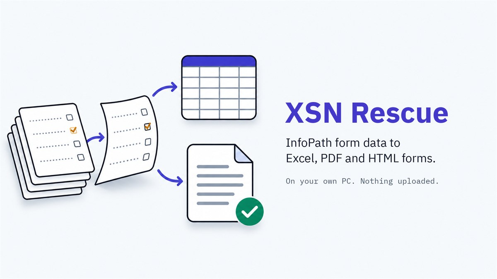
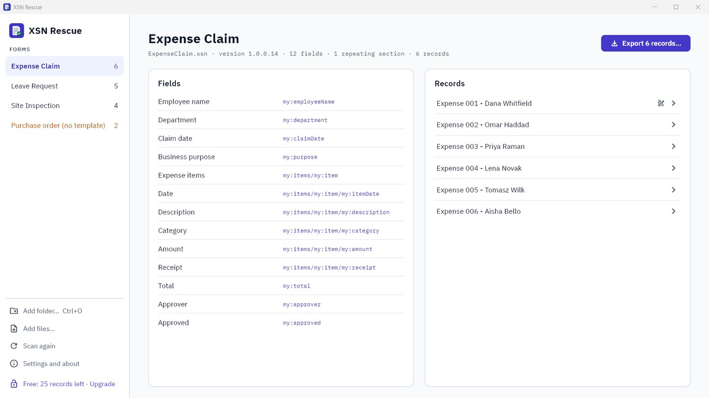
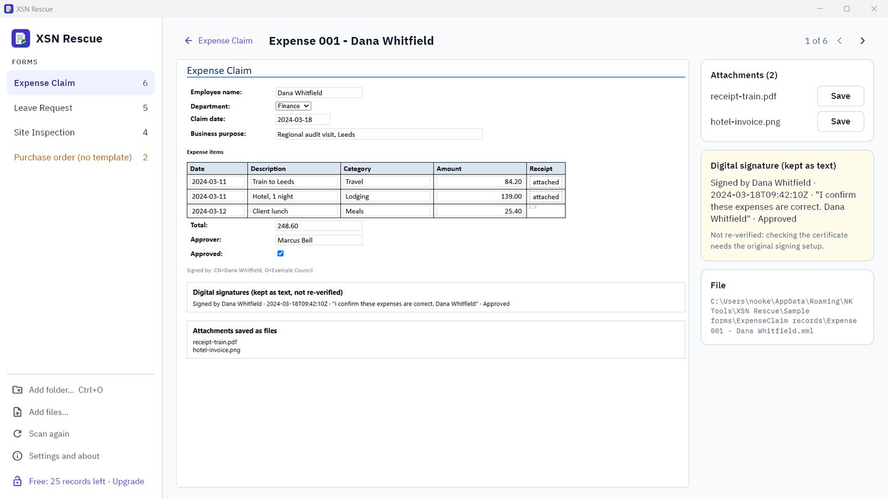
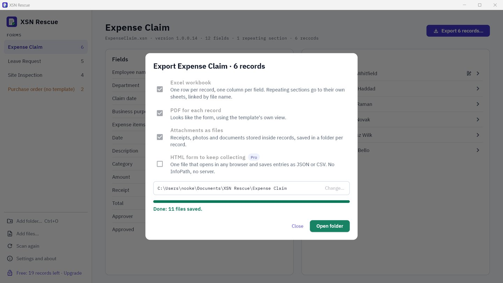

# XSN Rescue: InfoPath to Excel, PDF and HTML forms

Get your InfoPath form data out before something breaks. XSN Rescue turns InfoPath form templates (.xsn) and saved records (.xml) into an Excel workbook, a PDF per record and a plain HTML form, on your own Windows PC. Nothing is uploaded.

[**Get it from the Microsoft Store**](https://apps.microsoft.com/detail/9PPKV99C8H1Z?cid=github) · [Website](https://xsnrescue.pages.dev/) · [Privacy policy](https://xsnrescue.pages.dev/privacy/)

## Why now

InfoPath 2013 and InfoPath Forms Services in SharePoint Online reached end of support in July 2026 ([MC616550](https://mc.merill.net/message/MC616550)). On SharePoint Server, existing forms still load but get no more fixes or security updates ([Microsoft Q&A](https://learn.microsoft.com/en-us/answers/questions/5746668/post-infopath-end-of-life)). Nothing has broken yet. That makes now the time to move years of expense claims, leave requests and inspection checklists into formats that don't need InfoPath.

## What it does

- Reads InfoPath templates (.xsn) and records (.xml) without InfoPath or SharePoint
- Matches every record to its template, even when SharePoint called it template.xsn
- **Excel**: one row per record, one labelled column per field; repeating tables on their own sheet
- **PDF per record** that looks like the form, using the template's own view
- **Attachments** and pictures inside records saved as normal files
- **Digital signatures** kept as readable text
- **HTML form** (Pro): keep collecting the same data in any browser, saved as JSON or CSV
- Everything stays on your PC

## Pricing

Free to try: preview everything and export your first 25 records. Pro $199 one time (2 PCs), Business $449 one time (10 PCs). No subscription.

## Support

Email [anithabheesetty@gmail.com](mailto:anithabheesetty@gmail.com).

XSN Rescue is not made or endorsed by Microsoft. InfoPath, SharePoint and Excel are trademarks of Microsoft Corporation. This repository is the product page; the app's source is not published here.
